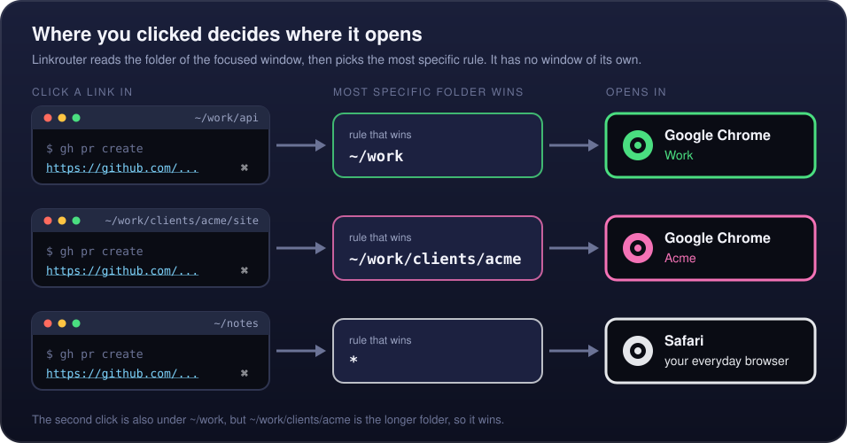

<p align="center"></p>

# Linkrouter

**Links open in the browser that belongs to the folder you clicked them in.**



Cmd-click a link in a terminal under `~/work` and it opens in Chrome's work
profile. Do the same under `~/work/clients/acme` and it opens in the Acme
profile. Anywhere else, it opens in your everyday browser. Linkrouter is a
macOS default browser that never shows a window: it looks at where you were,
picks a browser and a profile, and hands the link over.

## Install

### Homebrew (recommended)

```sh
brew install john-athan/tap/linkrouter
cp -R "$(brew --prefix linkrouter)/Linkrouter.app" /Applications/
```

Homebrew builds it from source with `swiftc` and puts `linkrouter` on your
PATH. The app has to be copied to `/Applications`, because the default browser
is tied to where the app is and Homebrew removes its own copy on every upgrade.
After `brew upgrade linkrouter`, copy it again.

### From source

```sh
git clone https://github.com/john-athan/linkrouter && cd linkrouter && make install
```

Installs `/Applications/Linkrouter.app`, registers it with macOS, and writes
`~/.config/linkrouter/rules` from `rules.example` if you have none. No Xcode
project, no package manager, nothing downloaded. To put `linkrouter` on your
PATH, it prints the one `sudo ln` line that needs. To upgrade, `git pull` and
`make install` again. A copy in `~/Applications` from 1.0.0 is moved over, and
stays the default browser.

### Then, once

1. Edit `~/.config/linkrouter/rules`
   (Homebrew: `cp -n "$(brew --prefix linkrouter)/share/linkrouter/rules.example" ~/.config/linkrouter/rules` first).
2. `/Applications/Linkrouter.app/Contents/MacOS/linkrouter --set-default`, and
   confirm the dialog macOS shows.
3. Open a link once. macOS asks for Accessibility access: allow it in System
   Settings → Privacy & Security → Accessibility.

## Rules

```
~/work                 Google Chrome: Default
~/work/clients/acme    Google Chrome: Profile 2
*                      Safari
```

A folder, two spaces or a tab, then an app and, after a colon, an optional
profile. The most specific folder that contains the clicked window's folder
wins, so the order of the lines does not matter. `*` takes everything else.

Write the profile as its directory ("Default", "Profile 2"). The name Chrome
shows ("Work") works only where macOS lets Linkrouter read Chrome's files; macOS
27 refuses that without asking. Where it is allowed, the name wins if both match.
Profiles work for Google Chrome, Chrome Beta, Chromium and Brave. A profile
Linkrouter cannot find opens nothing: it asks first, since Chrome would
otherwise create an empty profile of that name. The file is read on every link,
so an edit counts immediately.

To see which rule a folder gets, and the directory of a profile you named,
without opening anything:

```sh
linkrouter --which ~/work/clients/acme
```

## How it knows the folder

Every Mac window can name the document it shows, and other apps can read that
name through the Accessibility interface. Ghostty puts the shell's working
directory there, from the OSC 7 sequence its shell integration sends at every
prompt. It stays there while a program in the terminal changes the window
title, so a link printed by Claude Code, `gh` or a test runner still routes by
the folder the program was started in.

When a link arrives, Linkrouter reads that value from the focused window of the
app in front. Any other app that names its window's file or folder this way is
routed by that path too.

## What it does not do

- **It does not route by URL.** That is what Finicky and Velja are for, and
  both do it well. Linkrouter answers a different question: where you are, not
  where the link goes.
- **It does not know about apps that name no folder.** Links from Slack, Mail
  or a browser go to the `*` rule.
- **It does not open files.** A Cmd-clicked file path opens in whatever app
  macOS has for that file type. Only http, https and `.html` come here.
- **It is not tested with every terminal.** Ghostty is. Any terminal that sets
  the window's document from the working directory will work; one that does
  not gets the `*` rule.
- **It does not stay running.** It starts when a link arrives and quits five
  seconds after the last one.

## Permissions

One: Accessibility, to read the focused window's folder. Without it every link
goes to the `*` rule, so nothing breaks, it just stops routing.

Linkrouter is ad-hoc signed, so macOS keys the grant to a hash of the binary,
and every rebuild is a new app to it. After every upgrade:

1. Open System Settings → Privacy & Security → Accessibility.
2. Select Linkrouter and remove it with the minus button.
3. Open a link and allow it again.

## Privacy

No network. Linkrouter reads one value, the focused window's document, and
only when a link arrives. It writes one file, `~/Library/Logs/linkrouter.log`:
a line per link with the app, the folder, the chosen browser and the link's
host, so you can see why a link went where it did. Never the path or the
query, where sign-in codes and reset tokens travel. It is readable by you only
and stays under 256 KiB. More in [SECURITY.md](SECURITY.md).

## Uninstall

Pick another default browser in System Settings → Desktop & Dock, then
`make uninstall` from the checkout, or `brew uninstall linkrouter` and
`rm -rf /Applications/Linkrouter.app`. Your rules in `~/.config/linkrouter`
stay until you delete them.

## Development

```sh
make check              # build, then the tests (tools/validate.sh)
oss check linkrouter    # the same thing, through the fleet tool
```

`swiftc` over `Sources/`, no package manager. The rules, the profile lookup and
the log are plain functions under `Sources/Rules` and `Sources/Log`, tested in
`Tests/` without a window, a permission or a browser. `LINKROUTER_RULES` and
`LINKROUTER_LOG` point the binary at other files, for trying a rules file out
with `--which` before it goes live. Why it works the way it does is in
[docs/adr](docs/adr/README.md).

## License

MIT. See [LICENSE](LICENSE). Not affiliated with Google, Brave or Ghostty.
